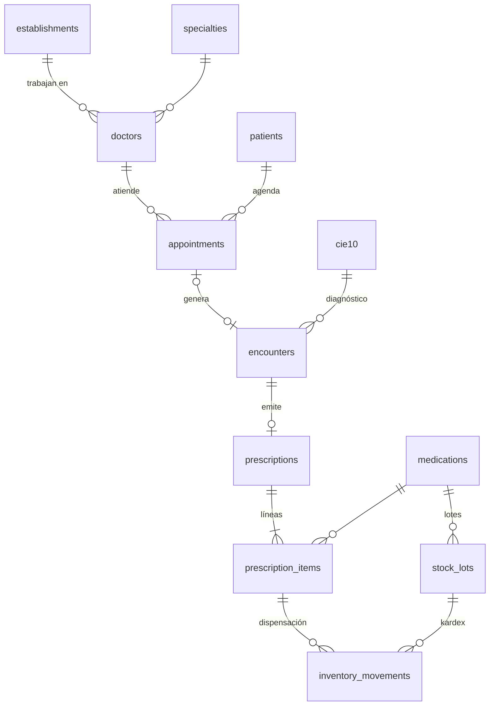
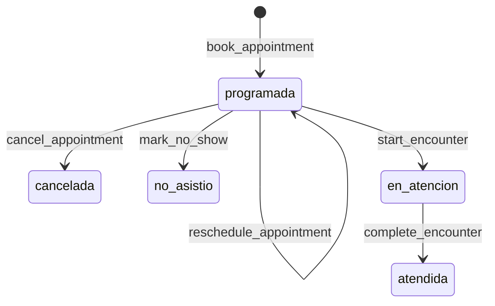
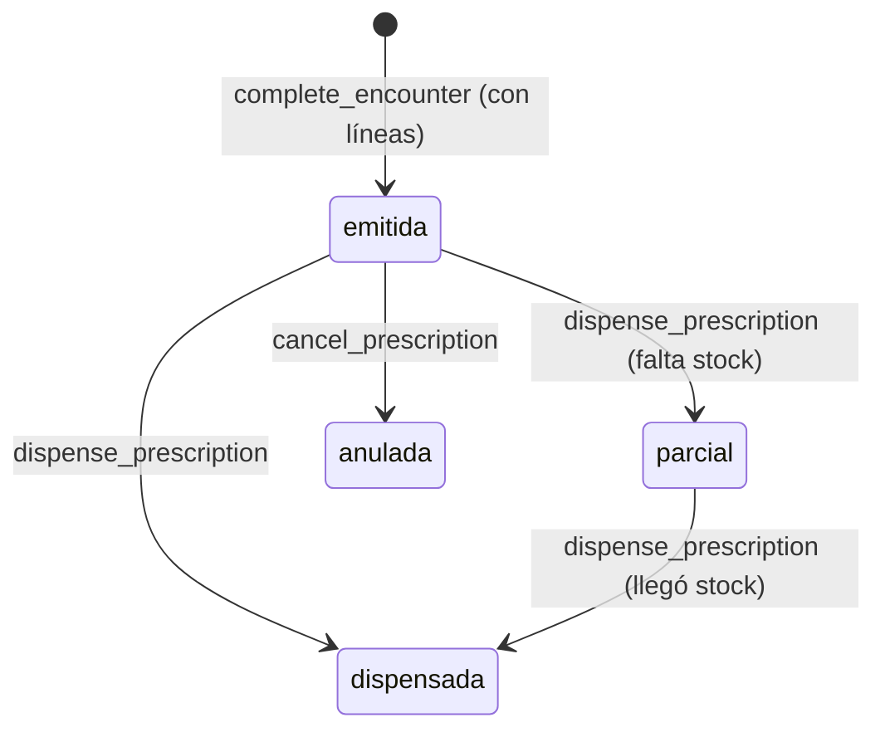

# Modelo de datos · Demo funcional CORDES

## Entidades

| Tabla | Qué representa | Nota |
|---|---|---|
| `patients` | Asegurado (titular o beneficiario) | `allergies` usa los mismos valores que `medications.allergen_group` |
| `appointments` | Cita / ficha | Índice único parcial: un médico no puede tener 2 citas activas en el mismo cupo |
| `encounters` | Atención médica = registro de la HCE | Signos vitales, hallazgos, CIE-10, plan |
| `prescriptions` / `prescription_items` | Receta y sus líneas | `quantity_dispensed` permite entregas parciales |
| `medications` | Catálogo (códigos reales del kardex CORDES) | `min_stock` define las alertas |
| `stock_lots` | Existencias por lote y vencimiento | El stock disponible es la suma de lotes vigentes |
| `inventory_movements` | Kardex: cada entrada o salida con signo | Saldo del lote = suma de sus movimientos (se verifica en la prueba) |

## Estados

Estado de stock por medicamento (`v_medication_stock.stock_status`): `agotado` (0) · `critico` (< 50 % del mínimo) · `bajo` (< mínimo) · `ok`.

## Conceptos para defender ante especialistas

- **Transacción atómica.** Dispensar toca 3 tablas: la línea de receta, el lote y el kardex. Si una falla, no debe quedar ninguna a medias. Por eso es una función en la base de datos (RPC) y no tres llamadas desde el navegador.
- **Bloqueo de filas (`SELECT … FOR UPDATE`).** Si dos farmacéuticos dispensan a la vez el mismo medicamento, el segundo espera a que termine el primero. Así el stock nunca queda negativo ni se vende dos veces la misma unidad.
- **FEFO (First Expired, First Out).** Se entrega primero el lote que vence antes y nunca uno vencido. Es la práctica estándar en farmacia hospitalaria y reduce las pérdidas por vencimiento.
- **Kardex.** El stock no se edita: se mueve. Cada cambio deja un registro (quién, cuándo, cuánto, por qué). Eso da trazabilidad y auditoría: es la diferencia entre una planilla y un sistema.
- **Reglas de negocio en la base de datos.** Que no haya doble reserva del cupo lo garantiza el índice único, no la pantalla. Aunque mañana se conecte una app móvil u otro sistema, la regla se mantiene.
- **CIE-10.** Clasificación Internacional de Enfermedades de la OMS. Codificar el diagnóstico es lo que permite después tener estadísticas (por ejemplo, "las 10 causas de consulta más frecuentes").

## Lo que la demo simplifica (y un sistema real no puede)

| Demo | Sistema real |
|---|---|
| Una sola farmacia (Planta Central) | Stock por farmacia, posta y almacén, con transferencias entre ellas |
| Sin login; acceso público con la anon key | Autenticación, roles (RBAC), auditoría por usuario, RLS por establecimiento |
| Agenda de lunes a viernes, 08:00–19:00, cupos de 20 min (definida solo en `demo_schedule()`) | Agendas configurables por médico, turnos, feriados, sobrecupos |
| Historia clínica mínima | HCE completa, firmas, adjuntos, interoperabilidad (HL7 FHIR) |
| Lotes y vencimientos simulados | Ingreso desde compras/SICOES, recepción y control de calidad |
| Datos ficticios | Datos sensibles de salud: cifrado, respaldo y cumplimiento normativo |
